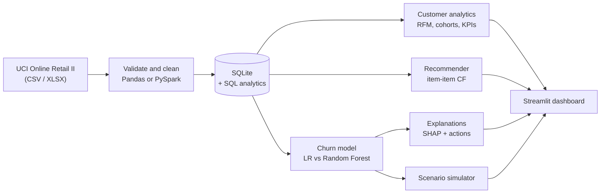

# E-Commerce Intelligence Platform
**Big Data analytics, explainable product recommendations and customer churn prediction** on a public e-commerce dataset, delivered as one interactive Streamlit dashboard.

> Built as a Big Data Analytics case study and portfolio project. Every number below was measured on the real dataset; where something is an assumption or cannot be measured, it says so.

## Business problem
An online retailer wants to (1) understand how customers buy, (2) suggest relevant products, and (3) spot customers who are likely to stop buying so the team can act early. This project answers all three from transaction history alone, and is explicit about what that data can and cannot support.

## What it does
| Module | What you get |
|---|---|
| **A. Customer analytics** | KPIs, sales trend, top products, countries, RFM customer segments, repeat-purchase behaviour, cohort retention, ordering patterns |
| **B. Explainable recommendations** | Ranked products per customer or per product, each with evidence (how many customers bought both, cosine similarity), a popularity cold-start fallback, and a chronological evaluation |
| **C. Churn prediction** | Churn probability and risk band per customer, SHAP explanations, rule-based retention suggestions, Logistic Regression vs Random Forest on a time-based split |
| **Big Data** | PySpark pipeline (cleaning, Spark SQL, aggregation) verified row-for-row against Pandas |
| **Business impact** | A transparent scenario simulator for retention offers: **estimates from assumptions, not measured effects** |

## Capability status
| Capability | Status |
|---|---|
| Data validation, cleaning, SQLite storage, SQL analytics | Implemented |
| PySpark batch pipeline (local mode), checked against Pandas | Implemented |
| Item-item recommender with evidence, chronological evaluation | Implemented |
| Churn models, calibration check, SHAP, risk bands | Implemented |
| 7-page Streamlit dashboard | Implemented |
| Retention scenario simulator | **Simulated** (assumption-based) |
| Retention action suggestions | Rule-based heuristics; effect **not tested** |
| Real-time / streaming processing | Not implemented |
| Category analysis, sales funnel, conversion, profit | **Not possible** with this dataset |

## Architecture


## Technology stack
Python, Pandas, NumPy, **Apache Spark (PySpark)**, SQLite + SQL, scikit-learn, SHAP, Streamlit, Plotly, Jupyter, pytest, Git/GitHub.

## Dataset
**Online Retail II**, UCI Machine Learning Repository: https://archive.ics.uci.edu/dataset/502/online+retail+ii
- Transactions of a UK-based online gift retailer, Dec 2009 to Dec 2011 (about 1.07M raw rows).
- Licence: **CC BY 4.0** (attribution required). Please use the citation text shown on the dataset page.
- Fields: invoice, stock code, description, quantity, invoice date, unit price, customer ID, country.
- **Not in the dataset:** churn labels, product categories, clickstream, demographics, costs. Churn is therefore *defined* here (see below) and funnel/category/profit metrics are not computed.
- The data is not stored in this repository. `python -m src.data.download` fetches it.

## Quick start
Python 3.12 is recommended.
```powershell
python -m venv .venv
.venv\Scripts\Activate.ps1                 # macOS/Linux: source .venv/bin/activate
pip install -r requirements.txt
python -m src.data.download                # or place online_retail_II.xlsx in data/raw/
python -m src.data.prepare --source data/raw/online_retail_II.xlsx
python -m src.recommendations.train
pip install -r requirements-explain.txt    # SHAP (optional)
python -m src.churn.train
streamlit run app.py
python -m pytest
```
Optional Spark step (needs Java 17 or 21 and `pip install -r requirements-spark.txt`):
```powershell
python -m src.spark.pipeline --source data/raw/online_retail_II.xlsx
```
Optional notebook: `pip install jupyter`, then open `notebooks/01_exploration.ipynb` in VS Code.

No dataset yet? `python -m src.data.prepare --demo` creates **clearly labelled synthetic** data so the app and tests can run. Never treat demo results as real.

## Results (real dataset, one run, random seed 42)
**Data quality.** 1,067,371 raw rows became 1,003,214 clean sales rows (34,335 duplicates, 19,104 cancellations moved to a returns table, 3,393 zero/negative quantities, 2,626 zero/negative prices and 4,699 fee/adjustment codes removed). 5,852 identified customers and 4,707 products. About 22.6% of sales lines have no customer ID, so customer-level results exclude them.

**Recommendations.** Trained on purchases before 11 Sep 2011, tested on the final 90 days, for 2,193 customers who bought new products in the test window. Already-bought products are never recommended.

| | Precision@10 | Recall@10 | NDCG@10 | Hit rate@10 |
|---|---|---|---|---|
| Popularity baseline | 0.041 | 0.019 | 0.044 | 29.2% |
| Item-item CF | **0.061** | **0.035** | **0.070** | **36.4%** |

Absolute scores are low because the task is hard (about 4,000 products, customers must buy something new). The model beats the baseline on every metric, but this is one test window.

**Churn.** Definition: a customer who ordered in the last 180 days **churns if they place no order in the next 90 days**. Two earlier snapshots train and validate; the latest full 90-day window is the held-out test.

| Test (cutoff 2011-09-11) | Precision | Recall | F1 | ROC-AUC | PR-AUC | Brier |
|---|---|---|---|---|---|---|
| Logistic Regression | 0.537 | 0.750 | 0.626 | 0.751 | 0.620 | 0.209 |
| Random Forest (selected on validation) | 0.542 | 0.780 | 0.640 | 0.760 | 0.632 | 0.209 |

Moderate discriminative power; useful for ranking customers, not for certainty. Observed churn rose with the risk band: **Low 9%, Medium 36%, High 63%**. The churn rate fell across snapshots (57%, 51%, 38%) and the test period includes the pre-Christmas season, so predicted probabilities ran higher than observed there. The Random Forest and Logistic Regression results are close; no significance test was run.

**Spark vs Pandas.** Every row count and the revenue total matched. On this ~1M-row file Pandas was faster (5.3s vs 19.9s including JVM start-up). Spark demonstrates a scalable architecture here; no speed-up is claimed.

## Example outputs
- *Similar products:* for "White Hanging Heart T-Light Holder", the top match is "Red Hanging Heart T-Light Holder": 632 customers bought both (cosine similarity 0.60).
- *Churn:* the highest-risk customers are one-order customers who last ordered 4 to 5 months earlier. Each score comes with SHAP factors and suggested actions.

## Screenshots
Add your own images to `docs/screenshots/` using these names.

| Page | Image |
|---|---|
| Overview |  |
| Customer Analytics |  |
| Product Recommendations |  |
| Churn Intelligence |  |
| Business Impact Simulator |  |
| Model Evaluation |  |
| Data and Methodology |  |

## Project structure
```
app.py                      page router (streamlit run app.py)
pages/                      overview, customer_analytics, recommendations, churn,
                            scenario, evaluation, methodology
src/config.py               paths and settings (no hardcoded machine paths)
src/data/                   load, clean, storage (SQLite), synthetic demo data, download, prepare
src/spark/pipeline.py       PySpark pipeline + Pandas parity check
src/analytics/              KPIs, SQL queries, RFM segments, cohorts
src/features/               churn features and labels (cutoff-based, leakage-guarded)
src/recommendations/        item-item recommender, training/evaluation CLI
src/churn/                  models, SHAP/linear explanations, actions, training CLI
src/business/               scenario simulator
src/evaluation/             ranking metrics, chronological split
tests/                      56 automated tests
notebooks/                  exploratory analysis notebook
docs/                       BIG_DATA.md, CHURN.md, PORTFOLIO.md, GITHUB_STEPS.md
data/, models/              data is never committed; small metric files may be
```

## How leakage is prevented
Recommendations: models are fitted on purchases before a cutoff and graded on later purchases. Churn: features use only orders before each cutoff, labels only orders after it, snapshots never overlap, label windows that run past the end of the data are refused, and scaling/imputation are fitted on training rows only. Tests check these guards.

## Limitations
- Churn is a documented definition, not an observed label; a different window gives a different model.
- One chronological test window for each model, containing the pre-Christmas season.
- Guest checkouts (no customer ID) cannot be used for customer-level results.
- SHAP values and feature importance show model associations, not causes.
- No experiment exists, so the simulator's save rate is an assumption. It does not show a campaign would reduce churn.
- Single machine, batch only: nothing here proves production-scale or real-time performance.

## Future improvements
Repeated-window backtesting with confidence intervals; hyperparameter search; hybrid recommender with text similarity; an A/B test design to measure real retention effects; scheduled retraining; deployment to a hosted environment.

## Documentation
[`docs/BIG_DATA.md`](docs/BIG_DATA.md) · [`docs/CHURN.md`](docs/CHURN.md) · [`docs/PORTFOLIO.md`](docs/PORTFOLIO.md) (LinkedIn and resume text) · [`docs/GITHUB_STEPS.md`](docs/GITHUB_STEPS.md)

## Licence
Code: MIT (see `LICENSE`). The dataset is **not** covered by this licence; it is CC BY 4.0 and credited to the UCI Machine Learning Repository above.
